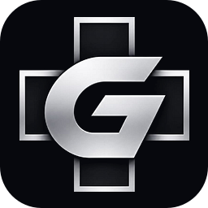
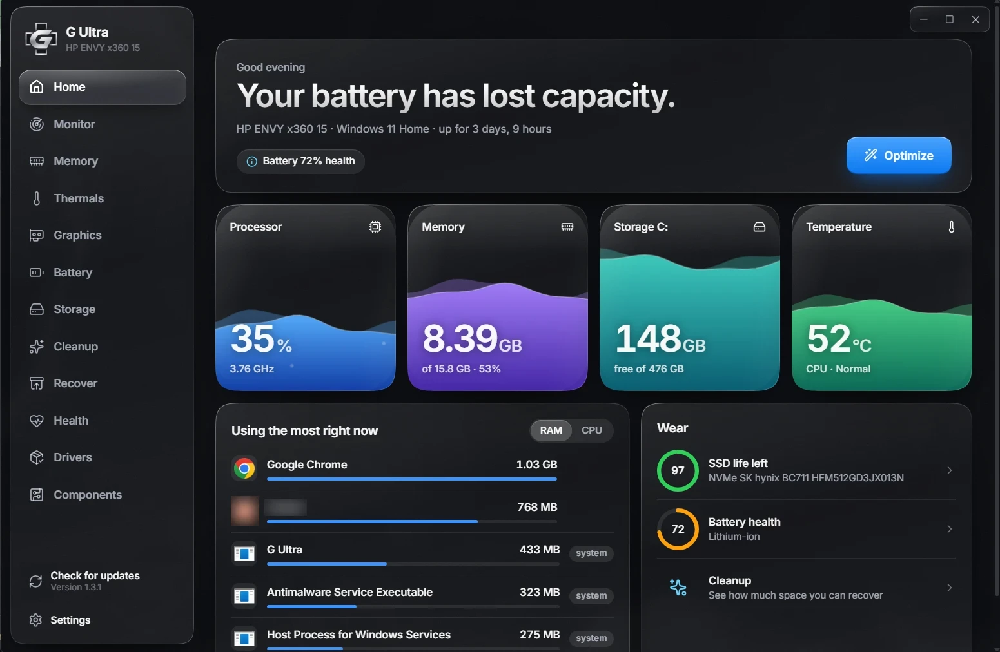
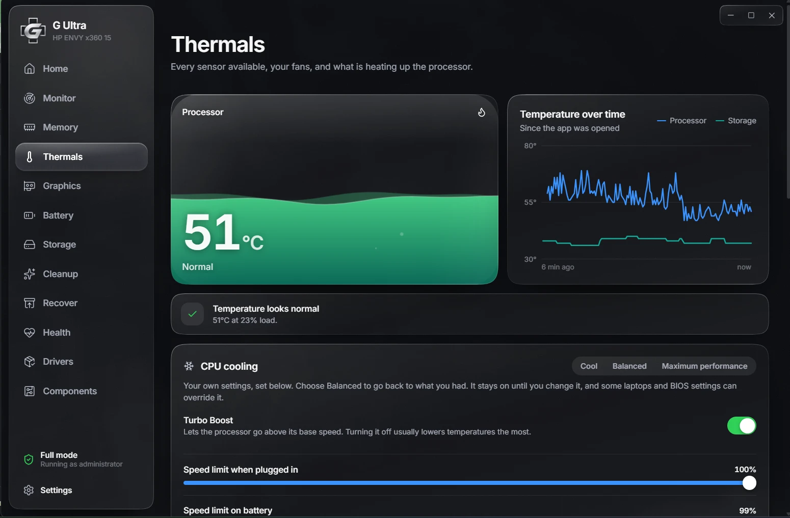
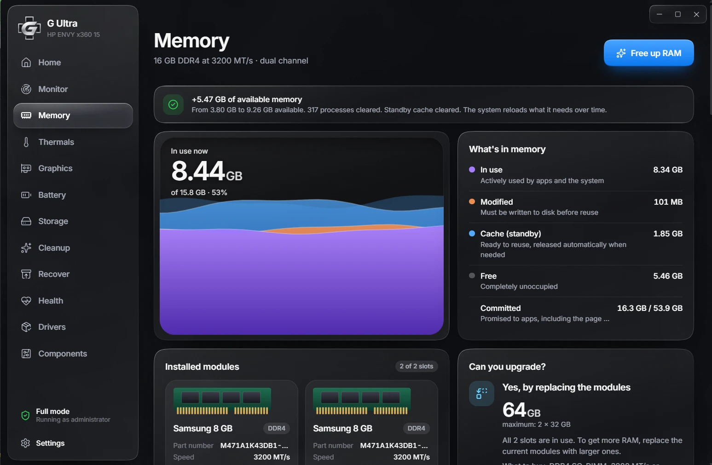
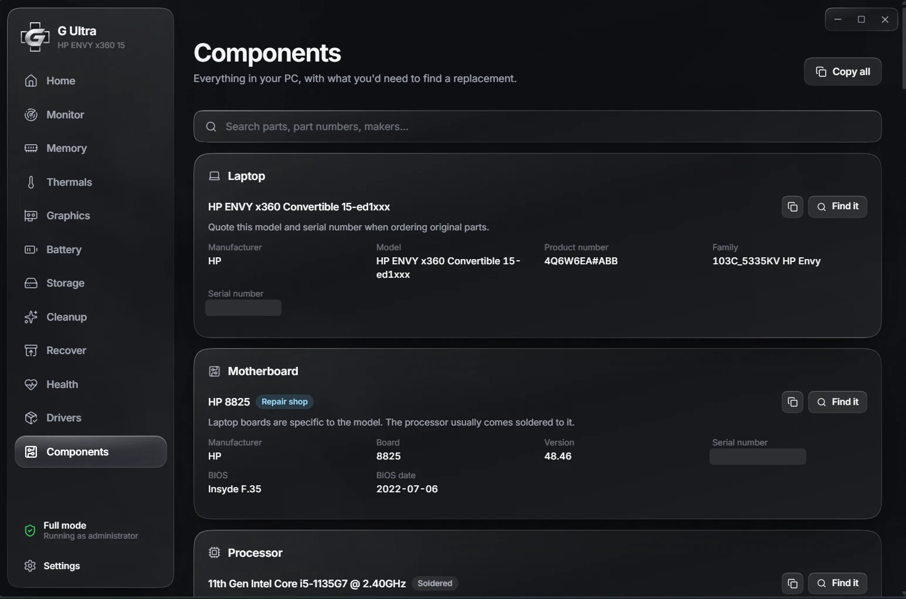

<div align="center">



# G Ultra

**See what your PC or phone is really doing, then fix it.**

Temperatures, RAM, disk wear, battery health, fans and cleanup in one dark, fluid glass app for Windows and Android.

[](https://github.com/Manvex/G-Ultra/releases/latest/download/G-Ultra-Setup.exe)
[](https://github.com/Manvex/G-Ultra/releases/latest/download/G-Ultra.apk)

[](https://github.com/Manvex/G-Ultra/releases/latest)
[](https://github.com/Manvex/G-Ultra/releases)
[](LICENSE)
[](https://github.com/Manvex/G-Ultra/stargazers)

</div>

## Screenshots

<table>
  <tr>
    <td></td>
    <td></td>
  </tr>
  <tr>
    <td></td>
    <td></td>
  </tr>
</table>

## What it does

| | |
|---|---|
| **Monitor** | Follow your system live, including from the background in a low-power mode, starting with your PC or phone. |
| **Memory** | See RAM type, modules and usage, what's using it, how far you can upgrade, and the health of each module. Free up RAM in one tap. |
| **Thermals** | Read temperatures, find out what's heating your CPU, and lower them with Cool mode, a Turbo Boost switch, speed limits and efficiency mode for single apps. |
| **Fans** | Set your own fan speeds, with safety limits that can't be turned off. |
| **Graphics** | See what's using your graphics card and adjust its settings, including Cool and Maximum performance modes on NVIDIA cards. |
| **Battery** | Check battery wear and use settings that save charge and extend its lifespan. Only appears on devices with a battery. |
| **Storage** | See what's filling your drives. |
| **Cleanup** | Remove caches and temporary files, without touching anything still in use. |
| **Recover** | Restore files from the Recycle Bin, or scan a drive for deleted files. On Android, restore what's still in the system trash. |
| **Health** | Check the wear on your SSD and other components. |
| **Drivers** | See your drivers and any devices with a problem, and install updates from Windows Update. You choose what gets installed, and a restore point comes first. |
| **Components** | List every part in your device, so you know what to buy when replacing one. |

### Automatic rules

The background monitor can act for you. For example, it can free RAM when usage passes a level you choose, close the processes you pick every few minutes, switch to Cool mode when the processor gets hot, or hold cooling at a set level.

Long jobs run in the background too, so you can keep using the app while a cleanup or scan finishes.

## Windows or Android

| | Windows | Android |
|---|:-:|:-:|
| Monitor and background rules | ✓ | ✓ |
| Memory, storage, cleanup and health | ✓ | ✓ |
| Components list | ✓ | ✓ |
| Battery | ✓ | ✓ |
| Thermals | ✓ | ✓ |
| Fan control | ✓ | |
| CPU cooling modes | ✓ | |
| Graphics settings | ✓ | |
| Driver updates | ✓ | |
| Recover from the trash | ✓ | ✓ |
| Deep scan for deleted files | ✓ | |
| In-app updates | ✓ | ✓ |

What you can read depends on your hardware and on what each system allows apps to access, and Android is the more restricted of the two.

## Install

### Windows 10 and 11

1. Download [the installer](https://github.com/Manvex/G-Ultra/releases/latest/download/G-Ultra-Setup.exe).
2. Run it. If Windows SmartScreen appears, select **More info**, then **Run anyway**. It appears because the installer doesn't have a paid code-signing certificate yet.
3. Leave the sensor driver ticked unless you have a reason not to (see below).

G Ultra asks for administrator rights because sensors and fan control need them. On a standard account it runs in limited mode.

#### About the sensor driver

Windows doesn't give apps direct access to CPU temperature sensors or fan controllers. To read them, G Ultra uses [PawnIO](https://github.com/namazso/PawnIO), a signed open-source driver.

The installer includes it as an option, ticked by default. If you untick it, everything else still works, but you won't see the CPU temperature, and fan control and temperature rules may not be available. You can add it later from the **Thermals** screen.

Uninstalling G Ultra removes PawnIO only if G Ultra was the one that installed it.

### Android 8 and later

Download [the APK](https://github.com/Manvex/G-Ultra/releases/latest/download/G-Ultra.apk), open it, and allow installs from your browser if Android asks.

To run in the background, Android requires a visible notification, and it may delay checks while the phone sleeps.

## Updates

When a new version is out, a popup tells you, and on Windows you can also check with the button in the sidebar. Press **Update**, and it does the rest.

On Windows, it downloads the new version, shows a setup window while it installs, and reopens by itself. On Android, it downloads the new version and Android asks you to confirm the install.

You can turn off the automatic check in Settings. The check contacts GitHub, and no data from your device is sent.

## Recovering deleted files

Deep scan reads an NTFS drive directly, without changing anything on it, and recovered files must go to a different drive so they can't overwrite what you're recovering. It needs administrator rights.

It can't promise results. Files that have been overwritten are gone, and SSDs usually erase deleted files soon after, so it works best on hard drives and USB sticks. Compressed and encrypted files can't be rebuilt.

On Android, no app can read permanently deleted files without root, so G Ultra restores what's still in the system trash and shows you other places to look.

## Built to be safe

- **Cleanup can't be pointed elsewhere.** The interface only sends category names, and the paths to delete are fixed in [`Cleaner.cs`](electron/helper/src/Cleaner.cs).
- **Important folders are off limits.** Cleanup refuses roots like `C:\`, your user profile, Windows and Desktop, and never follows junctions or symlinks.
- **Recent files stay.** Temp files newer than 24 hours and files in use are left alone.
- **Critical processes stay running.** Critical Windows processes can't be closed from the app.
- **Drivers come from one source.** Driver updates only come from Windows Update, and only the ones you choose are installed.
- **CPU settings can be undone.** Cooling modes only use Windows power settings. Balanced puts back what you had, and so does uninstalling G Ultra.
- **No direct overclocking.** G Ultra checks whether your processor can be overclocked and points you to the maker's own tool.
- **Fans have limits.** They can't go below 30%, and they return to automatic at 90°C on the CPU or GPU and whenever the app closes.

## Build it yourself

You need Node 22 or later. For Android, you also need Android Studio with JDK and SDK 36. The Windows helper compiles with `csc.exe` from .NET Framework, which ships with Windows.

```bash
npm install
```

Download the sensor libraries and the setup files the installer bundles, checking the setup files against pinned hashes:

```bash
npm run setup
```

Build the Windows installer:

```bash
npm run dist:win
```

To sign it with the code signing certificate on your PC, and check the result, use `npm run dist:win:signed` instead.

Build the Android APK:

```bash
npm run dist:android
```

The results land in `release/`. To publish a new version, raise the version in `package.json`, build both apps, commit and push, then run `npm run release -- "What changed"`. Installed apps find it from there.

On its first run, the Android build creates your own signing key in `android/`. Keep that key private and back it up, because phones only accept updates signed with the same key.

To work on the interface in a browser with demo data, add `?os=android` to the URL for the phone version:

```bash
npm run dev
```

### Project layout

| Folder | What's in it |
|---|---|
| `src/` | The React interface, shared by both platforms |
| `electron/` | The Windows app |
| `electron/helper/src/` | The native C# helper: RAM, processes, SMART, battery, cleanup, fans and GPU settings |
| `android/` | The Android app, built with Capacitor |
| `build/` | Icons and installer steps |
| `scripts/` | Build, icon and download scripts |

### Tests

These only touch their own temp folder, processes they create, and one registry value for a fake program, which they remove again:

```bash
node scripts/build-helper.mjs --selftest %TEMP%\gultra-test
```

```bash
%TEMP%\gultra-test\GUltraSelfTest.exe %TEMP%\gultra-test
```

## Contributing

Bug reports and pull requests are welcome. See [CONTRIBUTING.md](CONTRIBUTING.md) for what to include.

If G Ultra is useful to you, a star helps other people find it.

## License

G Ultra is free software under the [GNU General Public License v3.0](LICENSE). You can use, change and sell it, as long as anything you distribute based on it stays under the same license with its source available.

Bundled projects keep their own licenses, listed in [THIRD_PARTY_NOTICES.md](THIRD_PARTY_NOTICES.md). The license doesn't cover the G Ultra name or logo.
